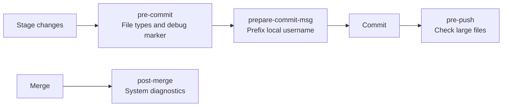

# Git Hooks · workflow checks

Four Bash hooks for local Git checks, commit-message annotation and post-merge diagnostics.



## Hooks in this repository

| Hook | Actual behavior |
| --- | --- |
| [pre-commit](pre-commits-proj/pre-commit) | Rejects staged `.tmp` / `.log` files; searches changed shell files for the exact case-sensitive marker `#Debug`. |
| [prepare-commit-msg](pre-commits-proj/prepare-commit-msg) | Prefixes the first message line with the local username from `whoami`. |
| [pre-push](pre-commits-proj/pre-push) | Searches the working directory for files larger than 1 MiB, excluding paths containing `.git/`. |
| [post-merge](pre-commits-proj/post-merge) | Prints disk usage, memory usage and running systemd services. |

## Install locally

Review the scripts first. In a standard clone, copy them into Git's local hooks directory:

```bash
git clone https://github.com/Fadi7AY/GitHooksProj.git
cd GitHooksProj
cp -i pre-commits-proj/* .git/hooks/
chmod +x .git/hooks/pre-commit .git/hooks/prepare-commit-msg .git/hooks/pre-push .git/hooks/post-merge
```

`cp -i` asks before overwriting an existing hook. These scripts assume Bash and Linux utilities; the post-merge diagnostics use `free` and `systemctl`.

## Test fixtures and limits

- [DEBUG_TEST.sh](DEBUG_TEST.sh) and [no_debug.sh](no_debug.sh) are text fixtures, not runnable shell programs.
- The debug fixture contains `#DEBUG`, while the hook searches for `#Debug`; they do not match.
- The pre-commit content check reads working-tree files, not the staged blob.
- The pre-push size check scans working-tree files, not just the commits being pushed.

These are local hooks. They do not establish server-side branch protection or CI enforcement.
